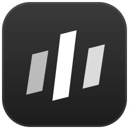
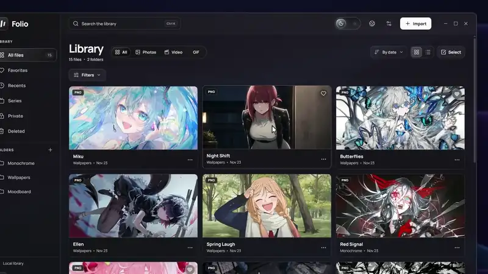
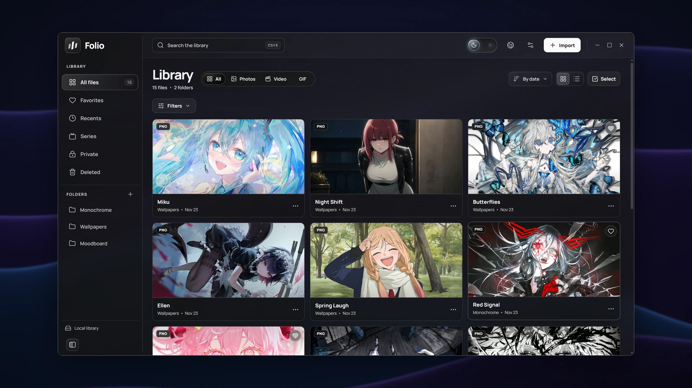
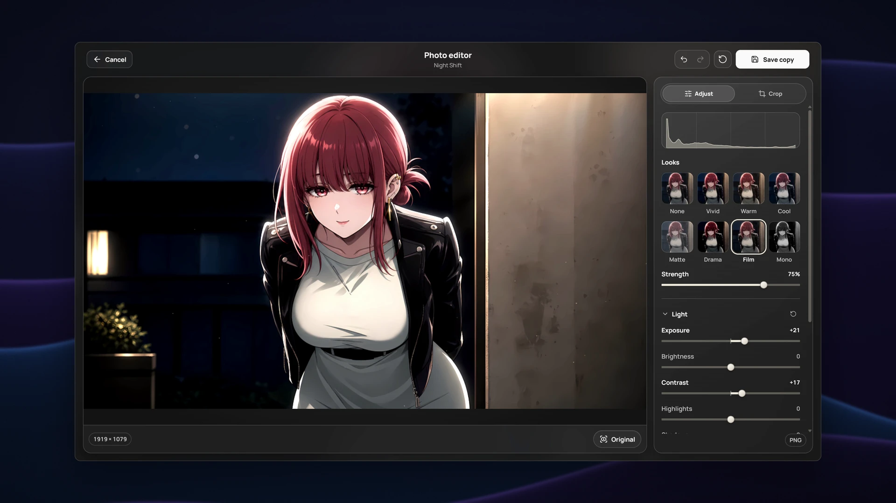
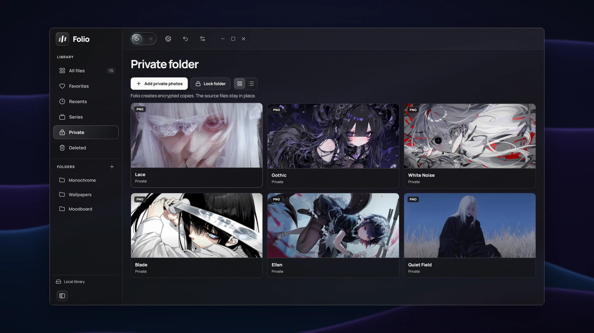
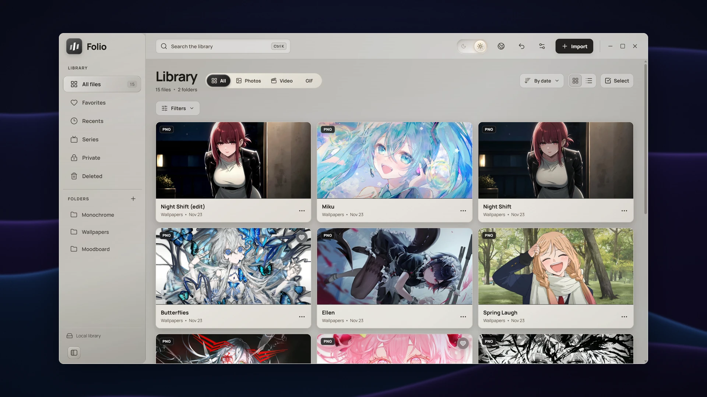

<p align="center">
  
</p>

<h1 align="center">Folio</h1>

<p align="center">
  <b>Photos, videos and series in one calm library that never leaves your disk.</b><br>
  A fast, private media gallery and player for Windows.
</p>

<p align="center">
  <a href="https://github.com/wasti4/folio-media-gallery/releases/latest"></a>
  <a href="https://github.com/wasti4/folio-media-gallery/releases"></a>
  
  <a href="LICENSE"></a>
  <a href="https://github.com/wasti4/folio-media-gallery/actions/workflows/ci.yml"></a>
</p>

<p align="center">
  <a href="../../releases/latest"><b>Download for Windows</b></a> ·
  <a href="#features">Features</a> ·
  <a href="#build-from-source">Build from source</a>
</p>

<p align="center">
  <a href="https://github.com/wasti4/folio-media-gallery/raw/main/docs/demo/folio-demo.mp4"></a>
</p>

<p align="center"><sub>Click the preview to download the full 76-second demo (MP4, 1080p at 60 fps).</sub></p>

## Why Folio

- **Your files stay yours.** Originals are copied into a library on your own disk. No account, no cloud, no telemetry.
- **Made for series.** Episodes group into seasons, and external dubs and subtitles are matched automatically.
- **Private when it matters.** An encrypted folder that locks itself the moment you step away.

## Screenshots

<table>
  <tr>
    <td></td>
    <td></td>
  </tr>
  <tr>
    <td></td>
    <td></td>
  </tr>
</table>

## Features

- **Library.** Import files or whole folders, or drop them in. Exact duplicates are skipped; folders, collections, tags and favorites keep things in order.
- **Watched folders.** Point Folio at Screenshots, Downloads or a camera folder, and new photos and videos come in on their own once they finish writing. What you delete in Folio stays deleted.
- **Search.** `Ctrl+K` finds anything. Filter by year, month, date range, tag or folder.
- **Viewer.** Zoom toward the pointer, pan, flip through with the arrow keys, go fullscreen.
- **Photo editor.** Seven looks with a strength slider, a live histogram, light, color and detail controls, crop, rotate and flip. Every step can be undone, **Original** compares on a click or while held, and **Save copy** keeps the source untouched.
- **Batch editing.** Select photos and give them one look, rotation and set of adjustments at once. Each photo gets its own copy next to the original.
- **Player.** Embedded MKV audio and subtitle tracks, plus external MKA, FLAC, AAC, MP3, WAV and AC3 audio and SRT, ASS, SSA or VTT subtitles. FFmpeg streams what Chromium can't play.
- **Series.** Numbered episodes form seasons, with watched marks and resume position that remembers your audio and subtitles.
- **Private folder.** Photos and their names are encrypted with AES-256-GCM. Thumbnails and edits stay in memory.
- **Safe deletes and backups.** Deleted photos wait in **Recently deleted**. Back up by hand or on a schedule; restores are checked against checksums.
- **At home on Windows 11.** Acrylic, light and dark themes, reduced motion, English, Russian and Simplified Chinese.
- **Updates.** Folio checks GitHub Releases once a day. An installed copy downloads the new installer on request, verifies its SHA-256 and restarts into the new version.

## Download

Get the latest build from [Releases](../../releases/latest):

- `Folio-x.y.z-Setup.exe`: per-user installer that also updates an existing installation. Installed copies update themselves from **Settings → Updates**.
- `Folio-x.y.z-portable.zip`: unzip anywhere and run `Folio.exe`. The portable build tells you when a new version is out, and you replace the folder yourself.

Requirements: Windows 10 or 11, 64-bit. FFmpeg is included.

The builds aren't code-signed yet, so SmartScreen may warn on first launch. Choose **More info → Run anyway**.

<details>
<summary><b>Keyboard shortcuts</b></summary>

| Keys | Where | Action |
| --- | --- | --- |
| `Ctrl+K` | Library | Search |
| `Ctrl+O` | Library | Import files |
| `Ctrl+A` | Selection | Select everything in view |
| `Ctrl+Z` | Library | Undo the last batch move |
| `←` `→` | Viewer | Previous or next photo |
| `Delete` | Viewer, selection | Move to Recently deleted |
| `Space` / `←` `→` | Player | Play or pause / seek 5 seconds |
| `F` / `M` | Player | Fullscreen / mute |
| `Ctrl+Z` / `Ctrl+Shift+Z` | Editor | Undo or redo a step |
| `\` (hold) | Editor | Show the original |
| `Shift` + arrows, double-click | Editor slider | Move by ten, reset to zero |
| `Esc` | Anywhere | Close the viewer, editor or selection |

</details>

## Your data

| What | Where |
| --- | --- |
| Library index and originals | `%APPDATA%\Folio\Library` (movable in **Settings**) |
| Thumbnails and playback cache | `%APPDATA%\Folio\media-cache` |
| Private folder | the `Folio Private` directory you choose |
| Downloaded updates | `%APPDATA%\Folio\Updates`, removed once installed |

Folio works fully offline. Its only network request is the daily check for a new version on GitHub, which sends nothing about you or your library; turn it off in **Settings → Updates**. Profiles from earlier builds in `%APPDATA%\Luma` move to `%APPDATA%\Folio` on first launch.

<details>
<summary><b>How the private folder works</b></summary>

- The key comes from your passphrase (12+ characters) via scrypt; each photo and the catalog of names are sealed with AES-256-GCM.
- The folder locks when you leave it, minimize or close Folio, lock Windows, or after five idle minutes.
- Private photos never enter the regular library, its cache or backups. To move the vault, close Folio and copy the whole `Folio Private` directory.
- There is no passphrase recovery. The vault protects data at rest, not a computer someone controls while it's unlocked.

</details>

## Build from source

You need Windows 10 or 11, Node.js 22 or newer, and FFmpeg with FFprobe on `PATH` (or in `FOLIO_FFMPEG_DIR`).

```powershell
npm ci
npm start
```

| Command | What it does |
| --- | --- |
| `npm start` | build the renderer and launch the app |
| `npm run dev` | browser preview with sample media |
| `npm test` | unit tests |
| `npm run test:ui` | end-to-end suites against Electron |
| `npm run package:win` | portable build in `release/` with bundled FFmpeg |
| `npm run package:win -- --installer` | portable build plus the Inno Setup installer |

`Folio.exe --intro` replays the first-launch tour. `FOLIO_TEST_PROFILE` points the app at a separate profile, and `FOLIO_UPDATE_FEED` points a development run at a test release feed; the end-to-end suites use both. The installer needs Inno Setup 6.6+ (`FOLIO_ISCC_PATH` for a custom location).

[GitHub Actions](.github/workflows/ci.yml) runs the unit and end-to-end suites on every pull request and every push to `main`. Alongside them it builds the installer, tests install, update, relaunch and uninstall, and keeps the installer, the portable zip and their checksums as a build artifact for 14 days.

<details>
<summary><b>How it works</b></summary>

```
desktop/           Electron main process
  main.mjs           windows, IPC, the folio:// protocol
  library.mjs        library index, import, collections, trash, backups
  watch-folders.mjs  watched folders: change events, settle checks, background import
  updates.mjs        update checks, verified installer downloads
  playback.mjs       FFmpeg probing, streaming and external tracks
  editing.mjs        photo and video export, wallpaper
  private-vault.mjs  the encrypted private folder
src/               React renderer: gallery, viewer, editor, player, series, onboarding
shared/            formats, series parsing, edits, looks, search, translations
tests/             unit tests and end-to-end suites
```

- The renderer is sandboxed and reaches the disk only through the `window.folio` bridge, which accepts calls from the app's own frame.
- Media streams over a privileged `folio://app` protocol with byte ranges, so large videos never load into memory.
- Library writes are queued and land atomically through a temporary file.

</details>

## License

[MIT](LICENSE). Windows builds bundle FFmpeg, which is licensed under the GPL; see the [release guide](docs/release.md) for its source and notices.
